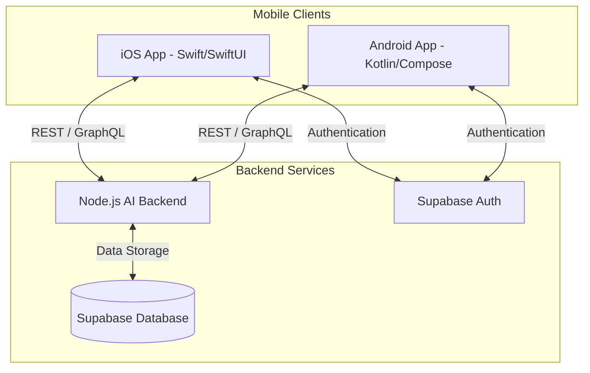

# Trimm Application - Progress Report

## Overview

**Trimm** is an AI-powered video editing application that allows users to turn rough recordings into polished, shareable content. It is designed to take talking-head and product clips and shape them naturally using AI. The application ensures privacy and performance by keeping video processing on-device while leveraging cloud-based AI for intelligent editing decisions.

## Architecture

The project consists of three main components:
1. **iOS Native Client** (Swift + SwiftUI)
2. **Android Native Client** (Kotlin + Jetpack Compose)
3. **Cloud Backend** (Node.js + Supabase)

### System Diagram

## Current Progress & Features

### 1. Cross-Platform Mobile Clients
- **iOS App**: Developed using SwiftUI and SwiftData. Features a custom `VideoDSL` for manipulating and trimming videos natively. 
- **Android App**: Developed using Kotlin and Jetpack Compose, maintaining feature parity with the iOS counterpart.
- **On-Device Processing**: Videos remain on the user's device for privacy and speed, applying edits locally rather than relying on expensive cloud rendering.

### 2. User Authentication
- Integrated **Supabase Auth** for secure user management.
- Supports **Sign in with Apple** and **Sign in with Google** directly from the mobile clients.
- Custom authentication nonces and crypto implementations are used for enhanced security.

### 3. AI-Powered Editing Pipeline
- The Node.js backend handles complex AI logic to interpret the video content and user intents.
- Users can view and manage their "Past Chats", indicating a conversational UI approach to video editing (e.g., instructing the AI to "remove all the pauses" or "cut to the product shot").
- A **Planner** and **Evidence** system on the client parses AI instructions and maps them to actual video cuts and transitions.

### 4. Cloud Infrastructure
- **Supabase** handles relational data mapping for user projects, chat history, and metadata.
- **Migrations** are version-controlled within `cloud/supabase/migrations` to maintain consistent schema states across environments.
- Environment variables and local development setups are streamlined via the Supabase CLI and npm scripts.

## Next Steps
- Finalize the generative AI prompts to improve the accuracy of edit decisions.
- Enhance the VideoDSL to support multi-track editing and more complex transitions.
- Conduct beta testing for both Android and iOS platforms to gather user feedback on the conversational editing experience.
