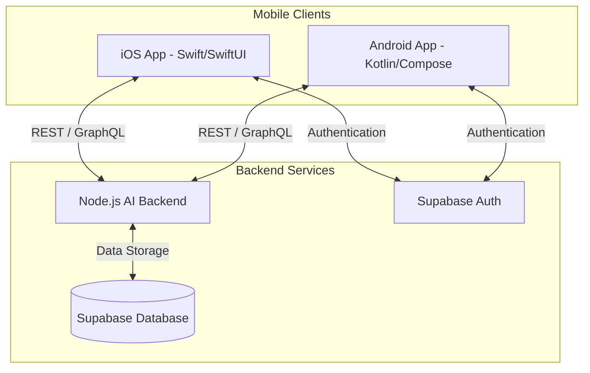

# Trimm Application - Progress Report

## Overview

**Trimm** is an AI-powered video editing application that allows users to turn rough recordings into polished, shareable content. It is designed to take talking-head and product clips and shape them naturally using AI. The application ensures privacy and performance by keeping video processing on-device while leveraging cloud-based AI for intelligent editing decisions.

## Architecture

The project consists of three main components:
1. **iOS Native Client** (Swift + SwiftUI)
2. **Android Native Client** (Kotlin + Jetpack Compose)
3. **Cloud Backend** (Node.js + Supabase)

### System Diagram

## Current Progress & Features

### 1. Cross-Platform Mobile Clients
- **iOS App**: Developed using Swift and SwiftUI (`@Observable`). Media pipeline built on AVFoundation (`AVMutableComposition`, `AVMutableVideoComposition`, `AVMutableAudioMix`) with CoreImage shader processing.
- **Android App**: Developed using Kotlin and Jetpack Compose. Media pipeline built on AndroidX Media3 (`CompositionPlayer`, `Transformer`, and Media3 Effects) ensuring exact preview-to-export fidelity.
- **On-Device Processing**: Video rendering, audio mixing, text overlays, and transitions remain strictly on-device for speed and privacy.

### 2. User Authentication & Billing
- Integrated **Supabase Auth** for secure user management.
- Supports **Sign in with Apple** (iOS) and **Sign in with Google** (via Credential Manager on Android and ASWebAuthenticationSession on iOS).
- Native in-app purchases powered by **Google Play Billing** (Android) and **StoreKit 2** (iOS) synced to Supabase credit balances.

### 3. Declarative AI Editing Pipeline
- The Node.js backend (`cloud/src/server.js`) interfaces with LLMs using structured function calling (`apply_schema_patch` tool).
- Edits are communicated as declarative **`CompositionSchema`** patches via Server-Sent Events (SSE).
- The schema directly specifies the video timeline (cuts, source offsets), subtitle/caption text nodes (styling, positions, visibility), audio nodes (background music, sound effects, auto-ducking), and transitions.
- The mobile clients act as deterministic renderers for this schema, maintaining a snapshot-based undo/redo history for every conversational revision.

### 4. Cloud Infrastructure
- **Supabase** handles relational data mapping for user projects, chat history, and metadata.
- **Whisper/AI Transcription Service**: Handles word-level timestamped transcription during initial video ingestion.
- **Migrations** are version-controlled within `cloud/supabase/migrations` to maintain consistent schema states across environments.

### 5. Unified Rendering & Transitions
- **Single-Engine Video Pipeline**: Both iOS and Android execute the identical rendering pipeline for real-time playback and final export. Android utilizes Media3's `CompositionPlayer` with OpenGL effect overlays (`TextGraphicOverlay`, `TransitionGraphicOverlay`), eliminating proxy transcode delays, 33ms polling loops, and text rendering divergence.
- **Cross-Platform Video Transitions**: Native on-device transitions (`crossfade`, `dip_to_black`, `dip_to_white`, `wipe`, `slide`) execute smoothly at 60fps across clip boundaries on both iOS (`AVVideoComposition` custom compositor) and Android (`BitmapOverlay` GL texture shaders).

## Next Steps
- Expand automated visual regression tests for transitions and overlays across both platforms.
- Conduct real-world user testing across varying Android GPU drivers and older iOS hardware.
